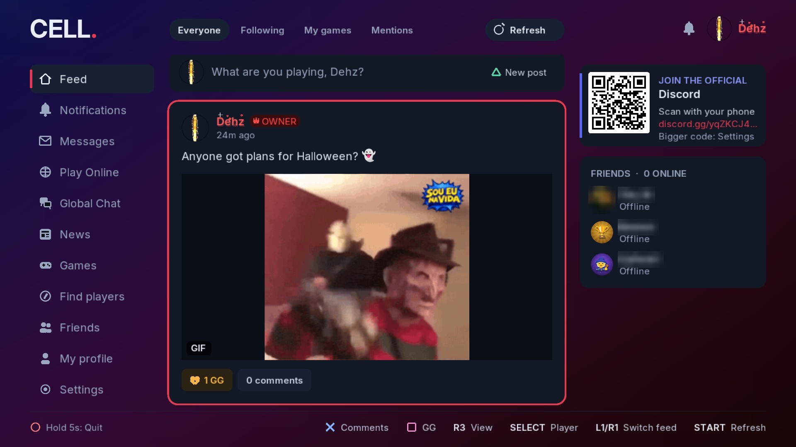
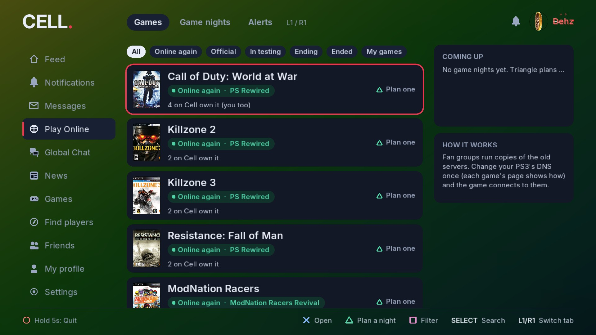
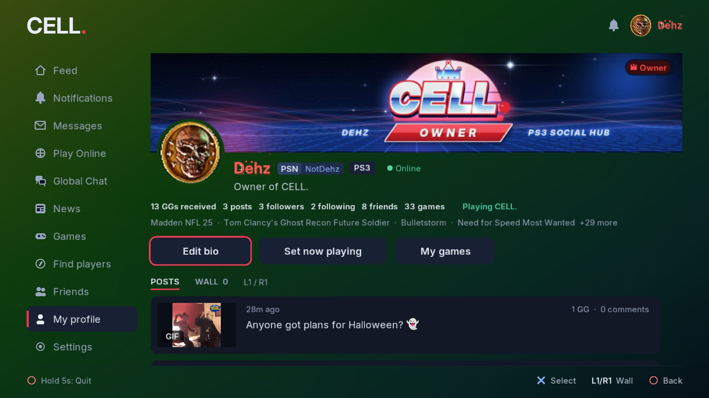
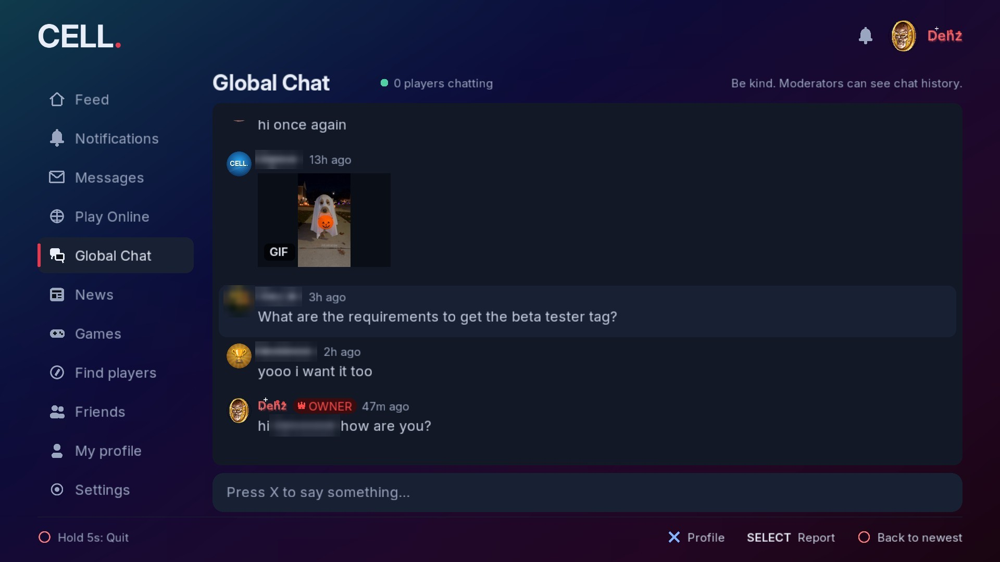
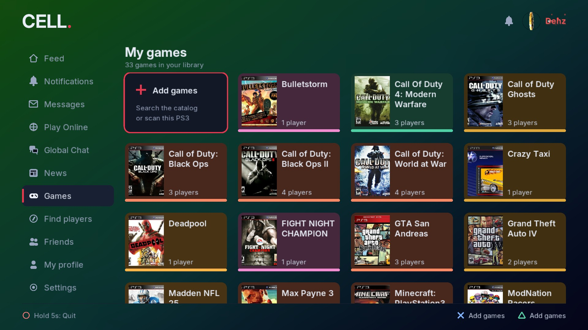
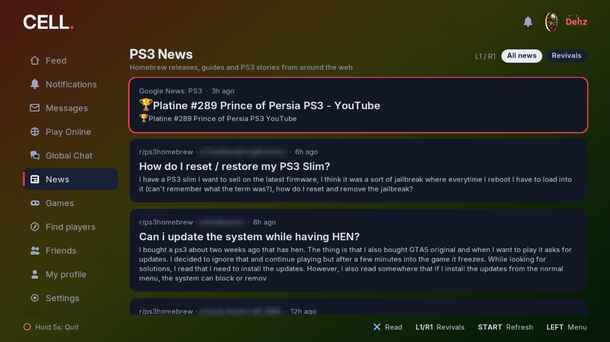

# CELL: The ONLY PS3 Social Media Application

**Cell** is a homebrew social app for the PlayStation 3. Make friends, post, comment, share screenshots and GIFs, chat, and find people to play revived online games with, all from your PS3.

This is the official page for Cell. **Download Cell only from the [Releases](../../releases) page here** (or from the update screen inside the app). Any other copy is unofficial.

> Cell is closed-source software by **Dehz**. This repository holds the official downloads, patch notes and license. The source code isn't published.

## Screenshots

| | |
|:-:|:-:|
|  |  |
| **Play Online:** 90+ revived games, with setup steps for each | **Profiles:** banners, badges, bios and your games |
|  |  |
| **Global Chat:** text, emoji and GIFs with everyone on Cell | **Games:** your library, and who on Cell owns the same games |
|  | |
| **News:** PS3 homebrew and revival news, readable in-app | |

---

## Download

1. Open **[Releases](../../releases/latest)** and download the PKG for your PS3:
   - **Cell-x.y.z-CFW.pkg** for Custom Firmware (Evilnat, Rebug and others)
   - **Cell-x.y.z-HEN.pkg** for PS3HEN
2. Copy it to a USB drive, or send it to the PS3 over FTP (for example into `/dev_hdd0/packages`).
3. On the PS3, go to **Package Manager → Install Package Files** and install it.
4. Start **Cell** from the Game column.

### Check your download

Each release lists the **SHA-256** checksum of every PKG. To check yours:

- **Windows (PowerShell):** `Get-FileHash .\Cell-1.1.2-CFW.pkg -Algorithm SHA256`
- **macOS / Linux:** `shasum -a 256 Cell-1.1.2-CFW.pkg`

If the numbers don't match the release page, delete the file and download it again from here.

### Updating

Cell tells you when a new version is out and can download it for you. If you missed it, or the in-app download doesn't work, grab the newest PKG from **Releases** and install it over the old one. **Your account, posts and friends are kept** because they live on the server and are backed up on your PS3.

---

## What Cell does

- **Profiles:** pick a unique username or use your PSN ID. Profile pictures (including animated GIFs), banners, bios, badges and a wall.
- **Feed:** posts with screenshots and GIFs, GGs (likes), comments and @mentions.
- **Messages:** private messages with friends, plus message requests from everyone else.
- **Global Chat:** one big chat for everyone on Cell, with "is typing...".
- **Play Online:** 90+ PS3 games kept alive by fan revival servers. Each has DNS steps, "It worked / It's broken" reports and game nights.
- **Friends, Find players, Notifications and News**, plus 30 colours and animated backgrounds.
- **Safety:** reporting, blocking, and staff moderation.

See **[CHANGELOG.md](CHANGELOG.md)** for everything that's changed in each version.

---

## Requirements

- A PS3 on CFW or PS3HEN
- An internet connection

## License

Cell is proprietary software. © 2026 Dehz, all rights reserved. See [LICENSE](LICENSE). You may install the official PKG on your own PS3. Re-uploading, modifying or repackaging it isn't allowed. Third-party components are listed in [THIRD_PARTY_NOTICES.txt](THIRD_PARTY_NOTICES.txt).

"PlayStation", "PS3" and "PSN" are trademarks of Sony Interactive Entertainment. Cell is not affiliated with or endorsed by Sony, or by any of the fan revival server projects it links to.
